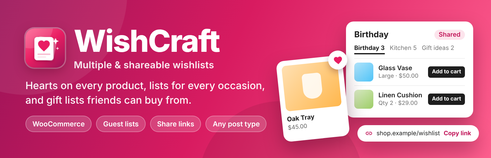
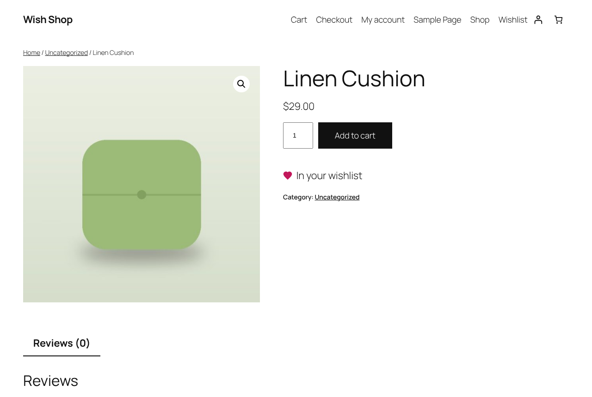
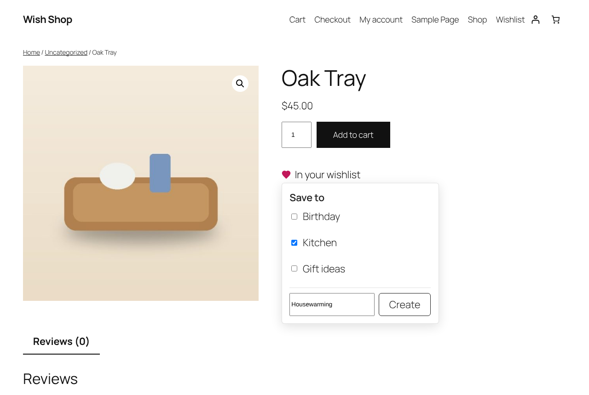
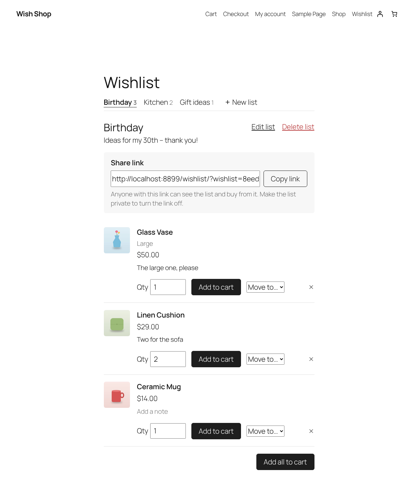
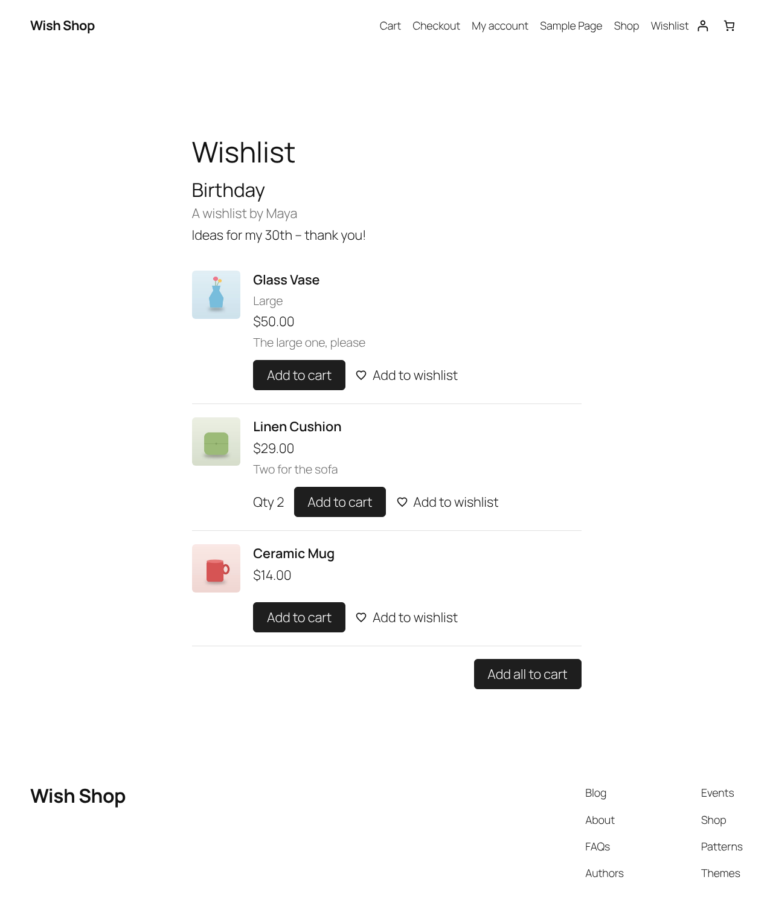
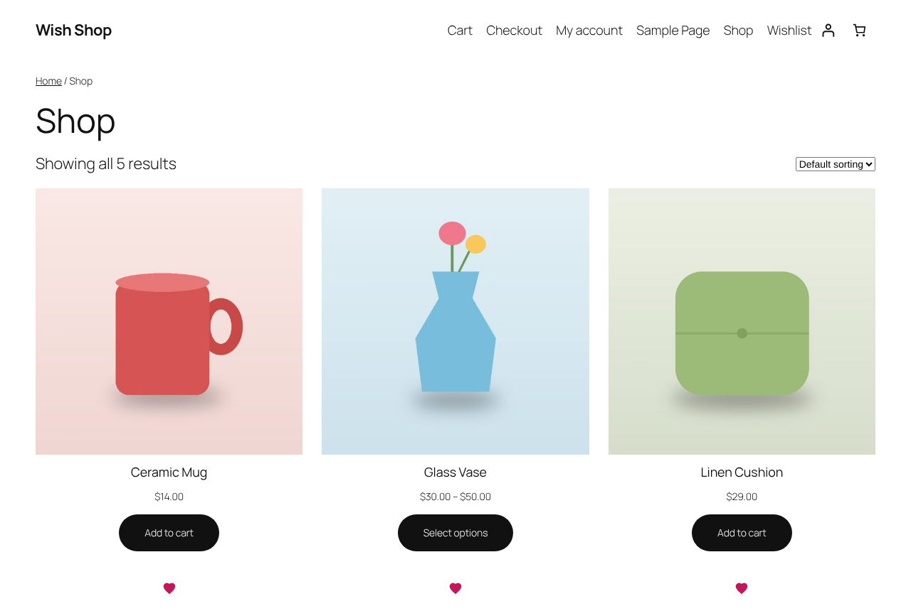

<p align="center">
  <a href="https://wordpress.org/plugins/wp-smart-wishlist/"></a>
</p>

<h1>
  
  WishCraft – Multiple &amp; Shareable Wishlists
</h1>

[](https://wordpress.org/plugins/wp-smart-wishlist/)
[](https://wordpress.org/plugins/wp-smart-wishlist/)
[](https://wordpress.org/plugins/wp-smart-wishlist/)
[](https://wordpress.org/plugins/wp-smart-wishlist/)
[](https://github.com/rajanvijayan/wp-smart-wishlist/actions/workflows/ci.yml)
[](https://www.gnu.org/licenses/gpl-2.0.html)

Wishlists for WooCommerce and any post type: several named lists, guest wishlists, share links and gift lists, for block and classic themes. WishCraft is the new name and rewrite of **WP Smart Wishlist**: the plugin slug is still `wp-smart-wishlist`, and wishlists saved with 2.0 move over automatically. Everything is free.

**[Download on WordPress.org](https://wordpress.org/plugins/wp-smart-wishlist/)** · [Changelog](readme.txt) · [Roadmap](docs/ROADMAP-3.0.md)

## Screenshots

| Product page | Choosing a list |
|---|---|
| [](.wordpress-org/screenshot-1.png) | [](.wordpress-org/screenshot-2.png) |
| **Wishlist page** | **Shared list** |
| [](.wordpress-org/screenshot-3.png) | [](.wordpress-org/screenshot-4.png) |
| **Shop** | |
| [](.wordpress-org/screenshot-5.png) | |

## Features

### ❤️ Wishlists
- **Several lists per visitor** ("Birthday", "Kitchen", "Gift ideas"), each with a name and description. Create, rename and delete lists on the wishlist page or straight from the heart button.
- **Quantities and notes** on each item, and **move** items between lists.
- **Guest wishlists** without an account, moved into the account at login or registration.
- **Any post type:** WooCommerce products, posts, or content from other plugins.

### 🔗 Sharing and gift lists
- Every list is **private**, **shared by link** or **public**.
- A share link that is hard to guess, with a copy button; making the list private turns it off.
- People who open a shared list see prices and stock and can **add the items to their own cart**, one by one or all at once, or save them to their own wishlist.

### 🛒 WooCommerce
- The heart on **product pages** and **product cards**, in block themes (WooCommerce blocks) and classic themes.
- **Variable products:** the chosen variation is saved and goes to the cart with its attributes.
- **Add to cart** per item and **Add all to cart** per list; optionally remove items once they are in the cart.
- Compatible with order storage (HPOS) and the cart and checkout blocks.

### 🎨 For any theme
- Blocks and shortcodes:

  | Block | Shortcode | |
  |---|---|---|
  | Wishlist (`wishcraft/wishlist`) | `[wishcraft]` | The visitor's lists, and lists opened through a share link (`?wishlist=token`) |
  | Wishlist Button (`wishcraft/button`) | `[wishcraft_button id="" label="yes"]` | Heart button for the current or given post |
  | Wishlist Counter (`wishcraft/counter`) | `[wishcraft_count label="no"]` | Number of saved items, linking to the wishlist page |

- A **Wishlist page** is created on activation; other post types get the button after their content.
- One small script without jQuery, loaded only where a wishlist is shown, and everything **works without JavaScript**.
- Cache friendly: buttons and counters load each visitor's state after the page loads.
- Accessible buttons and dialogs; responsive down to phone screens.
- Neutral styles that follow the theme. Override `--wishcraft-accent`, `--wishcraft-border`, `--wishcraft-muted`, `--wishcraft-surface` and `--wishcraft-radius`.

### 🔒 Privacy and upgrades
- No external services. Guests get an HttpOnly cookie with a random code; only a keyed hash is stored, and unused guest lists are deleted after 30 days.
- Suggested privacy policy text under Settings → Privacy.
- 2.0 wishlists become each user's "My wishlist" in the background, and the 2.0 widget keeps working. The 2.0 data is kept.

### Coming next
- Share buttons (email, WhatsApp, X, Facebook, Pinterest) and **collaborative lists** that friends and family can edit.
- A settings screen and a "most wishlisted" report.

## Requirements

WordPress 6.5 or later and PHP 7.4 or later. WooCommerce is optional.

## Development

```
composer install
npm ci && npm run build
composer lint                      # PHPCS (WordPress Coding Standards)
npm run lint:js && npm run lint:css
bin/install-wp-tests.sh wordpress_test root root 127.0.0.1 latest
WP_TESTS_DIR=/tmp/wordpress-tests-lib vendor/bin/phpunit
```

`vendor/` and `build/` are not committed. Releases are deployed to WordPress.org by GitHub Actions; see [`RELEASING.md`](RELEASING.md).

### Layout

| Path | |
|---|---|
| `install.php` | Plugin bootstrap (the file name is kept from 2.0) |
| `src/data/` | Tables, lists, items and members |
| `src/rest/` | REST API controllers |
| `src/front/` | Button, wishlist page, blocks, shortcodes and assets |
| `src/woo/` | WooCommerce integration |
| `src/legacy/` | 2.0 migration and widget |
| `assets/src/` | Front-end and block editor scripts and styles |
| `blocks/` | Block metadata |

### REST API (`wishcraft/v1`)

| Route | Methods | |
|---|---|---|
| `/lists` | GET, POST | The visitor's lists; create a list |
| `/lists/{id}` | GET, PATCH, DELETE | One list with its items; rename, describe, set privacy; delete |
| `/lists/{id}/share` | POST | New share link (the old one stops working) |
| `/lists/{id}/items` | POST | Add a post or product (`variation_id`, `quantity`, `note`) |
| `/items/{id}` | PATCH, DELETE | Change quantity, note or position; remove |
| `/items/{id}/move` | POST | Move to another list |
| `/toggle` | POST | Add to or remove from a list (the default list without `list_id`) |
| `/status?ids[]=` | GET | Which of the given posts are saved, the item count and the lists |
| `/shared/{token}` | GET | A list seen through its share link |
| `/view` | GET | Wishlist page markup, used by the script after each change |

Logged-in users authenticate with the usual REST nonce. Guests are recognised by their cookie, and their writes must send the `X-WishCraft: 1` header.

### Hooks

| Hook | |
|---|---|
| `wishcraft_supports_post_type` (filter) | Whether a post type gets wishlists |
| `wishcraft_button_html` (filter) | Button markup |
| `wishcraft_rest_item`, `wishcraft_rest_list` (filters) | Items and lists in REST responses and on the page |
| `wishcraft_item_actions`, `wishcraft_list_panel`, `wishcraft_list_footer` (filters) | Extra markup on the wishlist page |
| `wishcraft_item_added`, `wishcraft_item_removed` (actions) | After items change |

## License

GPL-2.0-or-later.
